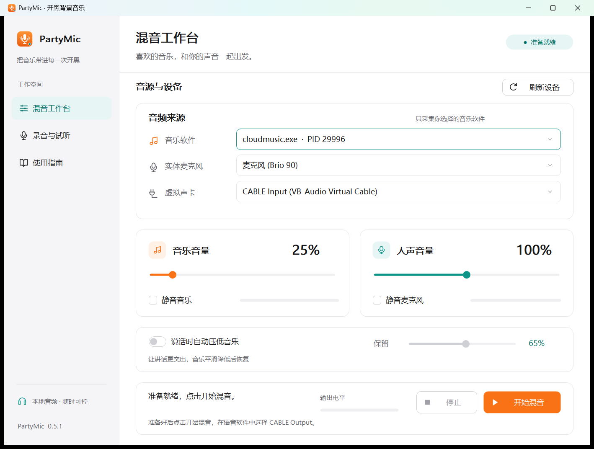

# PartyMic · 开黑背景音乐

把喜欢的音乐带进语音通话。PartyMic 将网易云音乐等软件的声音与真实麦克风混合，让队友同时听到背景音乐和你说话。

## 下载与安装

在 [发行页面](https://github.com/Kique261/PartyMic/releases) 下载 **`PartyMic-0.5.3-Setup.exe`**，双击并按向导完成安装，无需解压 ZIP。

- 支持 **Windows 11 x64**，需要一个实体麦克风。
- 安装到当前 Windows 账户，提供开始菜单、桌面快捷方式和卸载入口。
- 混音需要官方 **VB-CABLE**。已有驱动可直接使用；未安装时，请按 [安装说明](docs/install.md) 从 VB-Audio 官网单独安装并重启。
- PartyMic 安装程序不含 VB-CABLE 驱动，也不自动安装驱动。首次驱动安装需要管理员权限，PartyMic 日常运行不需要。
- 本程序和安装包尚未进行代码签名；请只从本仓库的发行页面下载。

## 开始混音

1. 在网易云音乐或其他音乐软件中播放一首歌。
2. 打开 PartyMic，点击“刷新设备 / 软件”。
3. 选择音乐软件、实体麦克风和 **CABLE Input**。
4. 点击“开始混音”。
5. 在 LOL 或语音软件的麦克风设置中选择 **CABLE Output**。

**设备别选反：** PartyMic 向 CABLE Input 输出，语音软件从 CABLE Output 接收。Windows 默认播放设备和语音软件的扬声器保持为耳机或音响。

推荐使用耳机，避免音响里的音乐再次被麦克风收进去。不要开启麦克风或 CABLE Output 的“侦听此设备”。

## 调整音量

音乐和人声音量可分别调节，也能单独静音。先从音乐 **25%**、人声 **100%** 开始，根据队友反馈调整。

“说话时自动压低音乐”默认关闭；开启后可选择讲话时保留的音乐比例。人声音量同时影响混音与仅人声录音。

## 录音与试听

在“录音与试听”中选择“仅人声”或“音乐 + 人声”，点击“录制 15 秒”。可提前停止，录音会保存在桌面的 **PartyMic录音** 文件夹，格式为 WAV。

试听时选择实际使用的耳机、HDMI 或扬声器，再点击“试听刚才录音”。试听前会停止混音；试听结束后，需要手动重新开始混音。录音只保存在本机，不自动上传。

## 帮助

- [安装、升级与卸载](docs/install.md)
- [完整使用说明](docs/usage.md)
- [没有声音、音乐发闷或断音](docs/troubleshooting.md)

语音软件的降噪、自动增益、语音门限和按键说话设置可能影响背景音乐，请通过该软件提供的设置调整。

PartyMic 不修改游戏文件或反作弊设置，不提供腾讯 LOL / ACE 兼容性认证或零封号承诺。如游戏或反作弊提示冲突，请停止使用。
