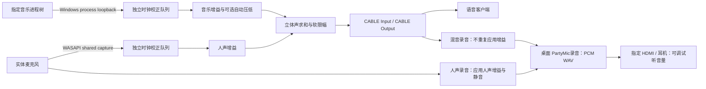

# 架构与音频行为

适用版本：0.5.0。维护入口见 [development.md](development.md)，历史变更见 [../CHANGELOG.md](../CHANGELOG.md)。

## 数据路径

`core/mixer.*` 不依赖 Windows，负责有界立体声队列、时钟校正、独立增益、静音、语音包络和限幅。`windows/devices.*` 枚举设备和音频会话，使用 Toolhelp 读取进程元数据，不打开音乐或游戏进程句柄。

`windows/audio_engine.*` 独占本程序的混音工作线程，打开音乐进程树 loopback、实体麦克风 capture 和 VB-CABLE render。48 kHz、双声道 float32、共享 WASAPI；每路有界队列容量 60 ms，初始化预填充 30 ms，独立的 64 抽头 Blackman 窗 sinc 读取速率平滑调整在 ±0.5% 内，目标队列余量约 20 ms。共享的归一化系数表含 1024 个相位间隔，构造时初始化，读取时插值相邻相位系数；历史帧提供约 31 帧的因果滤波延时，欠载、溢出和直接 FIFO 读取时重置时钟/历史状态。这些是内部参数，不是端到端延迟承诺。

`windows/preview.*` 使用独立线程做短录音或文件回放，不向混音工作线程加入磁盘 I/O。每次只进行一项录音/试听。录音在内存中积累，默认 15 秒，上限 30 秒，结束或提前停止后写入唯一文件名。文件格式为 48 kHz、16 bit、双声道 PCM WAV；没有自动 MP3 编码、上传或云端处理。录音路径通过 Windows 已知桌面文件夹解析，兼容桌面重定向。

`windows/main.cpp` 持有两个引擎，更新 UI 和增益。试听前先停止混音，不会自动恢复。关闭窗口会停止录音/试听和混音；至少 0.1 秒的部分录音会保存。

## 音量和自动压低

| 设置 | 范围 / 默认值 | 作用 |
| --- | --- | --- |
| 音乐音量 | 0–200% / 25% | 数字采集音乐的增益 |
| 人声音量 | 0–200% / 100% | 混音和“仅人声”录音共用；不改 Windows 设备音量 |
| 自动压低音乐 | 默认关闭 | 仅影响数字音乐，不处理音响拾音或频谱 |
| 讲话时保留音乐 | 25–100% / 65% | 开启压低后生效；不是“减少百分比” |
| 试听音量 | 0–100% / 70% | 只影响文件回放，不改已保存录音、系统或网易云音量 |

人声包络超过 0.025 且瞬时电平超过 0.012 时触发保持，保持约 250 ms。可选音乐压低的下降平滑时间常数为 80 ms，恢复为 500 ms；检测包络使用 10 ms / 300 ms 时间常数。关闭压低时也平滑恢复，避免瞬时跳变。无压低、未触发限幅且增益稳定时，音乐和人声只是线性求和；核心测试用 12 kHz 音乐 + 300 Hz 人声验证这一点。

求和绝对值超过 0.8 后使用软拐点限幅，最大幅度小于 0.98。若人声音量过高，仍会改变强峰值波形，应降低人声增益，而不是把限幅当作音质增强。人声单独录音使用相同软拐点行为；混音录音直接读取实际 CABLE Output，不二次限幅或增益。

## 外放与音质边界

0.1.0 默认把音乐降到 25%，用户报告讲话时音乐听感明显变差。此为已知强衰减因素，但没有证明它是唯一原因：音响声音经房间、显示器 3.5 mm 输出和麦克风再次进入混音，可能产生延迟、反射和染色。在数字音乐下降后，这条声学路径占比会更明显。

0.2.0 默认关闭压低，保留温和可调选项；并提供仅人声/混音录音用于对比。当前没有软件 AEC、语音识别、降噪、自动增益或音色修复；驱动自带处理也可能影响麦克风。耳机对比用于隔离声学拾回。本次私有流探测发现 Brio 端点在 Communications 类别下报告 AEC 开启并提供参考端点控制，在 Other 类别下报告 AEC 关闭；尚未接入实际混音或评估效果。后续若添加 AEC，应只处理麦克风分支，保留干净数字音乐；必须有与实际扬声器对应且时间对齐的参考信号，并重新评估双人同时讲话和音乐失真。

官方参考：[Windows 音频处理模式](https://learn.microsoft.com/en-us/windows-hardware/drivers/audio/audio-signal-processing-modes)、[Microsoft AEC 示例](https://github.com/microsoft/Windows-classic-samples/tree/main/Samples/AcousticEchoCancellation)、[Windows 默认通信压低](https://learn.microsoft.com/en-us/windows/win32/coreaudio/stream-attenuation)。Windows 或语音客户端的通信处理与本程序压低是独立机制，不能因为本程序关闭压低就推断客户端不会改变音乐。

## 设备与退出约束

混音仅输出官方立体声 VB-CABLE，不允许系统默认播放/通信播放指向该混音端点。试听列表排除 VB-Audio 和 Steam Streaming，工作线程重新检查端点方向与类型，防止回放写入虚拟线路。混音录音目前仅支持标准 `CABLE Input` / `CABLE Output` 配对；扩展到多个 Cable A/B 前必须实现明确配对。

不访问游戏内存，不注入、不挂钩，不改变 ACE、测试签名或驱动安全设置。只使用系统音频 API 与已签名官方 VB-CABLE。这些约束不等同于 ACE 认证或零封号承诺。

## 原生界面

`main.cpp` 负责三页导航、布局和音频状态绑定；`page_transition.h/.cpp` 管理内容快照淡入，页面控件只布局一次，200 ms 内用系统 AlphaBlend 合成，结束释放位图与覆盖层；`ui_theme.h/.cpp` 统一颜色、圆角、图标与原生控件绘制，使用 Windows 系统 GDI+。继续保留普通 Win32 控件、键盘操作和原音频线程，不引入浏览器运行时。细节见 [ui-design.md](ui-design.md)。
